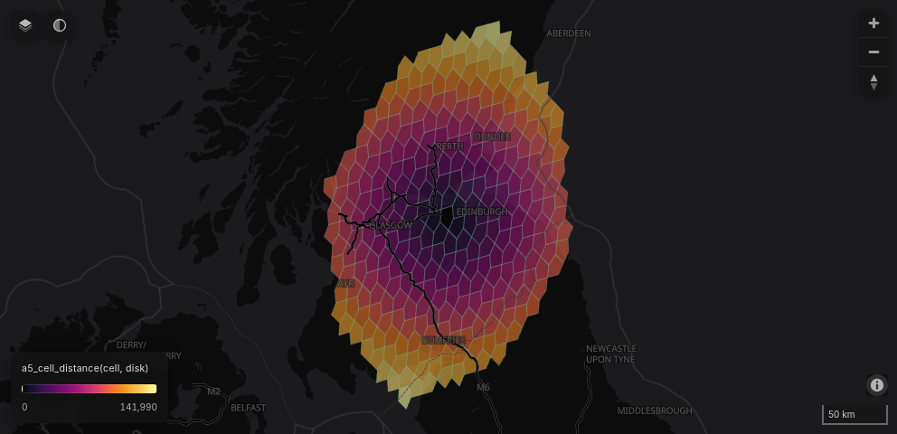
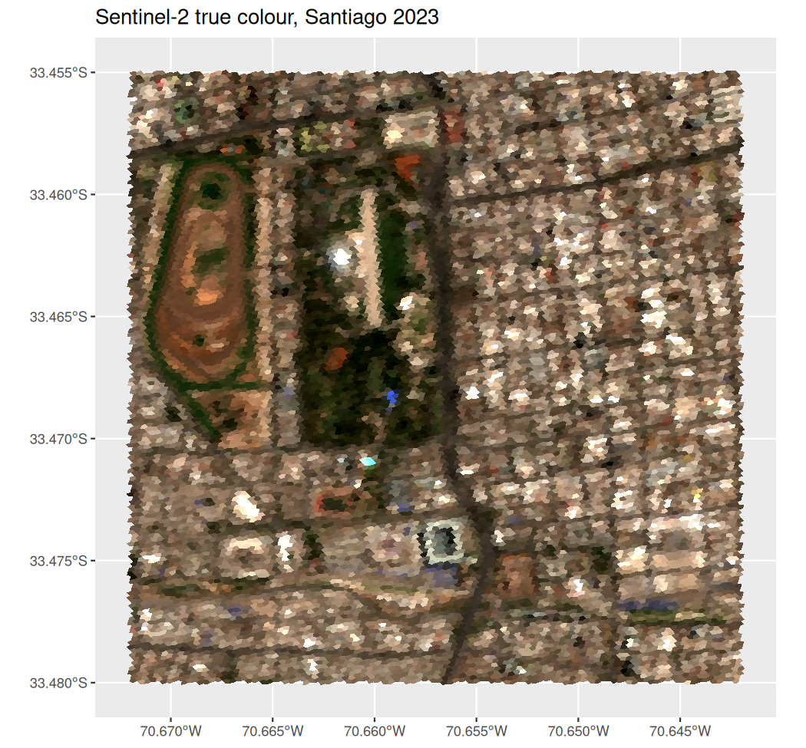
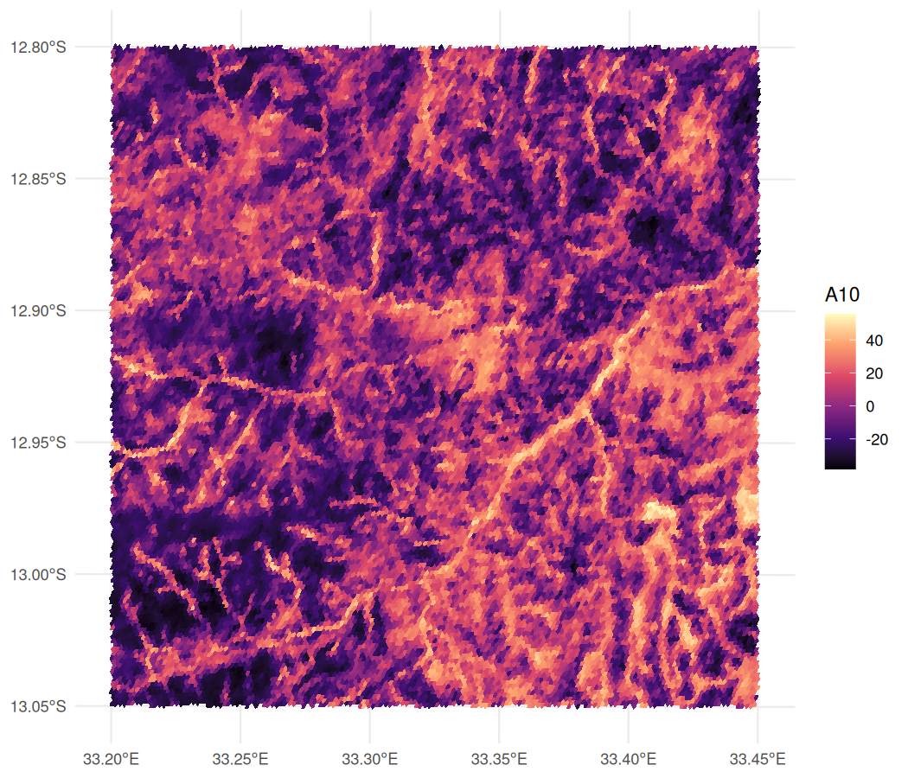

<!-- README.md is generated from README.Rmd. Please edit that file -->

# a5view

<!-- badges: start -->

[](https://lifecycle.r-lib.org/articles/stages.html#experimental)
[](https://github.com/belian-earth/a5view/actions/workflows/R-CMD-check.yaml)
<!-- badges: end -->

Interactive map viewer for [A5](https://a5geo.org) geospatial cells,
powered by [deck.gl](https://deck.gl) over a
[MapLibre](https://maplibre.org) basemap. Renders cells directly in the
browser with deck.gl’s A5Layer and
[a5-js](https://github.com/felixpalmer/a5); no pre-computation of
boundaries needed. Intentionally minimal API for fast prototyping and
exploration of A5 data.

## Installation

``` r
# install.packages("pak")
pak::pak("belian-earth/a5view")
```

a5view 0.3.0 draws [A5
1.0](https://github.com/felixpalmer/a5/blob/main/CHANGELOG.md) cell ids,
as produced by a5R \>= 0.9.9.9000. Ids written by earlier versions of
a5R are valid 1.0 cells in the wrong place, so a5view cannot tell them
apart and draws them where 1.0 puts them; convert them once with
`a5R::a5_migrate()`. Use a5view 0.2.x for pre-1.0 ids.

## Usage

``` r
library(a5R)
library(a5view)

# Pick a cell and expand to a disk
cell <- a5_lonlat_to_cell(-3.19, 55.95, resolution = 9)
disk <- a5_grid_disk(cell, k = 10) |>
  a5_uncompact(resolution = 9)

# Colour by distance from centre
a5_view(disk, fill = a5_cell_distance(cell, disk), palette = "Inferno")
```



Features:

- Colour mapping from numeric vectors or data frame columns with any
  `hcl.colors()` palette, with an on-map legend
- Basemaps from [OpenFreeMap](https://openfreemap.org) (dark, light,
  OSM; no API key) and Esri satellite imagery, with an interactive
  selector; map labels render above the cells
- Opacity slider, zoom/compass control, scale bar
- Hover tooltip with the cell id, fill value and any extra columns
  (`tooltip = c("col1", "col2")`); click to pin a cell; nothing shows
  over empty map
- Cell border styling
- 3D extrusion via `elevation`
- Globe projection (`globe = TRUE`)
- Precomputed level-of-detail pyramids for large datasets
  (`aggregate = "rep_child"` / `"mean"`), streamed to the browser as
  parquet and decoded per viewport; inside Shiny the file is served with
  HTTP range requests so only the row groups in view are transferred
- Shiny bindings (`a5_viewOutput` / `renderA5_view`) and in-place
  updates via `a5_view_update()`
- Optional polygon-draw toolbar (`draw_polygon = TRUE`) for selecting an
  area of interest

## ggplot2

`geom_a5()` draws cells in ggplot2, alongside `geom_sf()` layers and in
any `coord_sf()` projection. Large cell sets are drawn as a raster at
the output resolution, so a plot of millions of cells costs about the
same as one of thousands.

The package ships `aef_malawi`, 23,691 resolution-15 cells of the
[AlphaEarth Foundations](https://source.coop/tge-labs/aef) satellite
embedding over central Malawi. Mapping three embedding axes through
`cells_rgb()` gives a false-colour composite; its output is already
colour, so no scale is needed.

``` r
library(ggplot2)

ggplot(aef_malawi, aes(cell = cell, fill = cells_rgb(A10, A11, A12))) +
  geom_a5() +
  labs(title = "AEF embedding axes A10-A12 as RGB")
```



Any fill scale works, and `coord_sf()` reprojects the cells, here to UTM
zone 36S:

``` r
ggplot(aef_malawi, aes(cell = cell, fill = A10)) +
  geom_a5() +
  scale_fill_viridis_c(option = "magma") +
  coord_sf(crs = 32736) +
  theme_minimal()
```



The AlphaEarth Foundations Satellite Embedding dataset is produced by
Google and Google DeepMind (CC-BY 4.0).

## Polygon draw mode (Shiny only)

Setting `draw_polygon = TRUE` adds a draw-polygon toggle to the toolbar.
Clicks place vertices, a double-click closes the polygon, and the result
is sent to Shiny as a WKT string at `input$<id>_polygon_draw`. The
widget itself does not visualise which cells fall inside the polygon —
the canonical pattern is to resolve the WKT server-side and update the
map fills via `a5_view_update()`. Outside Shiny there is no input
listener, so the feature has no effect.

``` r
a5_viewOutput("map")

# server
output$map <- renderA5_view({
  a5_view(my_cells, draw_polygon = TRUE)
})

observeEvent(input$map_polygon_draw, {
  cells_in_poly <- a5R::a5_polygon_to_cells(
    wk::wkt(input$map_polygon_draw),
    resolution = 4L
  ) |>
    a5R::a5_uncompact()
  # ... use cells_in_poly, e.g. a5_view_update() with selection-driven fills.
})
```

See `inst/examples/polygon-select/app.R` for a complete demo combining
single-cell click selection with polygon-based selection.
