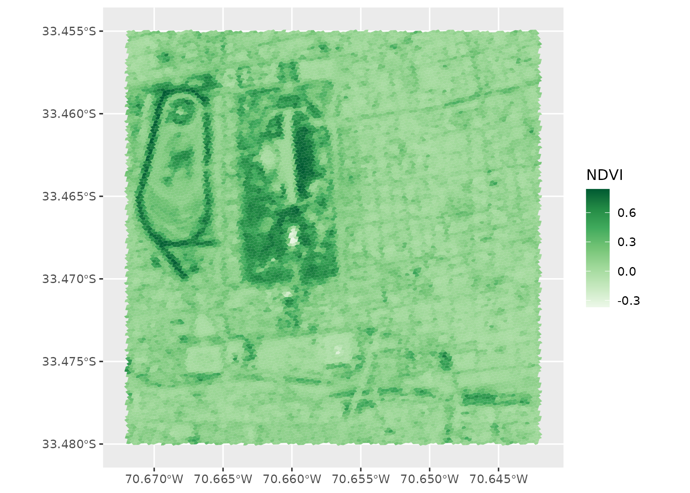
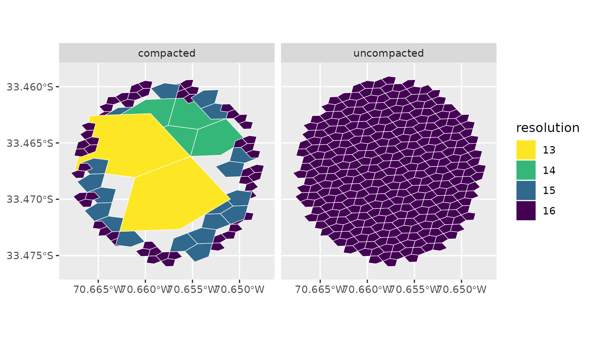
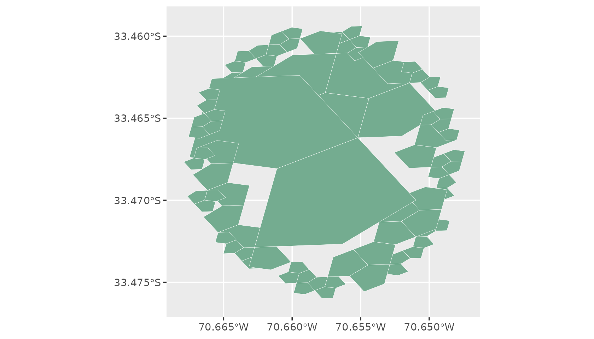
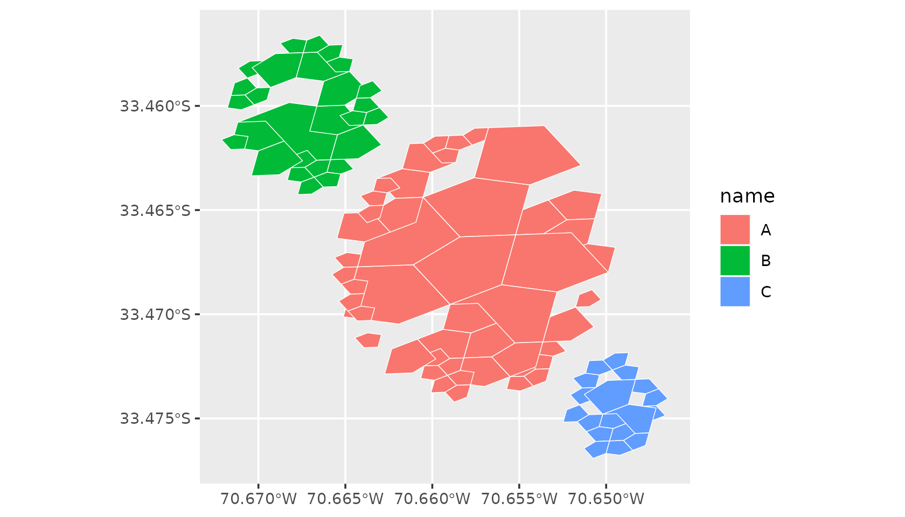
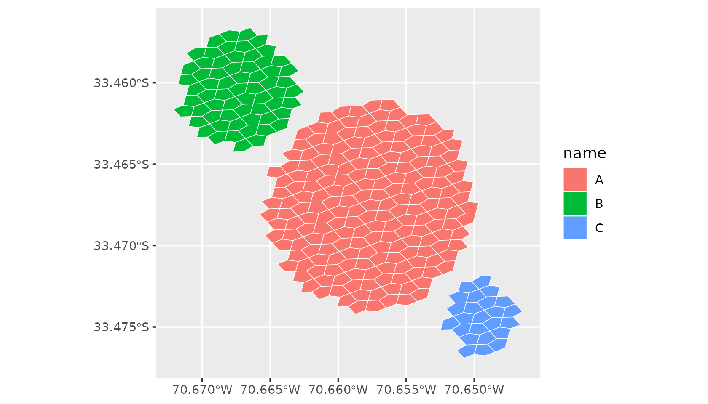
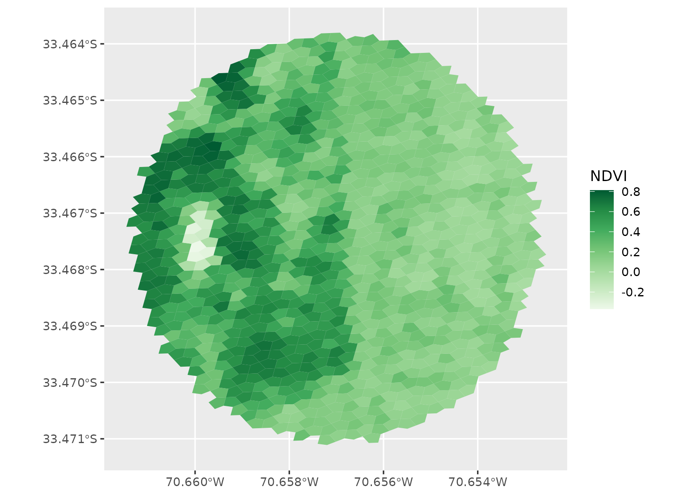

# Get started with a5view

a5view draws [A5](https://a5geo.org) cells, the pentagonal cells of a
global, equal-area grid. [a5R](https://belian-earth.github.io/a5R/)
makes and works with the cells; a5view draws them in two ways:
[`geom_a5()`](https://belian-earth.github.io/a5view/reference/geom_a5.md)
adds them to a ggplot2 plot, and
[`a5_view()`](https://belian-earth.github.io/a5view/reference/a5_view.md)
puts them on an interactive web map. Both take the same input:

- an `a5_cell` vector, or a data frame with an `a5_cell` column, one
  cell per row;
- an `a5_covering` vector, or a data frame with an `a5_covering` column,
  one set of cells per row (see [Coverings](#coverings)).

``` r

library(a5view)
library(a5R)
library(ggplot2)
```

## Cells

[`a5_lonlat_to_cell()`](https://belian-earth.github.io/a5R/reference/a5_coordinates.html)
gives the cell that contains a point at a chosen resolution. Resolution
0 has 12 cells over the globe, and each further resolution has about
four times as many; at resolution 18 a cell is about 22 m across.
`s2_santiago`, which ships with a5view, holds a Sentinel-2 image of
central Santiago, Chile, already indexed to resolution-18 cells:

``` r

head(s2_santiago)
#>               cell  B02  B03  B04  B08
#> 1 32b5c12040800000 1919 2165 2432 2445
#> 2 32b5c12041800000 1259 1575 1831 2254
#> 3 32b5c12042800000 2047 2414 2597 2807
#> 4 32b5c12043800000  989 1228 1441 2077
#> 5 32b5c12044800000 1305 1527 1663 2179
#> 6 32b5c12045800000 1121 1355 1569 2023
```

In ggplot2 the cells go to the `cell` aesthetic, and every other
aesthetic works as usual. Here the fill is NDVI, a vegetation index
computed from the near-infrared and red bands:

``` r

s2_santiago$NDVI <- with(s2_santiago, (B08 - B04) / (B08 + B04))

ggplot(s2_santiago, aes(cell = cell, fill = NDVI)) +
  geom_a5() +
  scale_fill_distiller(palette = "Greens", direction = 1)
```



[`a5_view()`](https://belian-earth.github.io/a5view/reference/a5_view.md)
takes the same data. `fill` names a column, or an expression of columns,
as [`aes()`](https://ggplot2.tidyverse.org/reference/aes.html) does:

``` r

a5_view(s2_santiago, fill = NDVI, opacity = 0.8)
```

Hover over a cell to see its id and value; click to pin it.

## Coverings

A *covering* is a set of cells at one resolution that stands for an
area: the cells within a radius of a point, around a cell, or inside a
polygon. a5R builds them with
[`a5_spherical_cap()`](https://belian-earth.github.io/a5R/reference/a5_spherical_cap.html),
[`a5_grid_disk()`](https://belian-earth.github.io/a5R/reference/a5_grid_disk.html)
and
[`a5_polygon_to_cells()`](https://belian-earth.github.io/a5R/reference/a5_polygon_to_cells.html).

A covering is stored *compacted*: wherever all four children of a parent
cell are present, the parent is stored in their place, so a large
covering stores far fewer cells than it stands for. a5R’s [coverings
article](https://belian-earth.github.io/a5R/articles/coverings.html)
covers this in detail.

Here is the area within 900 m of the centre of Parque O’Higgins, at
resolution 16 (cells about 73 m across):

``` r

centre <- a5_lonlat_to_cell(-70.657, -33.4675, resolution = 16)
park <- a5_spherical_cap(centre, radius = 900)
park
#> <a5_covering[1]>
#> [1] res 16: 324 cells (81 stored)

# cells it stands for, and cells it stores
a5_count(park)
#> [1] 324
length(a5_covering_stored(park))
#> [1] 81
```

### Compacted or uncompacted

a5view draws what it is given. A covering is drawn as the cells it
stores, at their mixed resolutions;
[`a5_uncompact()`](https://belian-earth.github.io/a5R/reference/a5_compaction.html)
expands it to the cells it stands for, all at resolution 16. Which to
draw is your choice: the compacted form shows how the covering is
stored, the uncompacted form the area it covers.

``` r

stored <- a5_covering_stored(park)
expanded <- a5_uncompact(park)
both <- data.frame(
  form = rep(c("compacted", "uncompacted"), c(length(stored), length(expanded))),
  cell = c(stored, expanded)
)
both$resolution <- factor(a5_get_resolution(both$cell))

ggplot(both, aes(cell = cell, fill = resolution)) +
  geom_a5(colour = "white", linewidth = 0.2) +
  facet_wrap(~form) +
  scale_fill_viridis_d(direction = -1)
```



The stored parents do not line up exactly with the children they stand
for: A5 cells nest in the index, not in space, so a parent’s outline
overlaps its neighbours in places and leaves gaps in others. Drawn
uncompacted, the covering shows exactly the cells it holds.

The covering can go straight to
[`geom_a5()`](https://belian-earth.github.io/a5view/reference/geom_a5.md)
or
[`a5_view()`](https://belian-earth.github.io/a5view/reference/a5_view.md),
with no data frame:

``` r

ggplot() +
  geom_a5(aes(cell = park), fill = "#74ac90", colour = "white")
```



``` r

a5_view(park, border = "white")
```

And uncompacted:

``` r

a5_view(a5_uncompact(park), border = "white")
```

### Coverings in a data frame

An `a5_covering` vector holds one covering per element, so it fits in a
data frame column next to the attributes of each area. a5view repeats
each row once per stored cell, so the other columns map to aesthetics as
usual. Here are three sites around the park, each with its own radius:

``` r

sites <- data.frame(
  name = c("A", "B", "C"),
  lon = c(-70.657, -70.667, -70.649),
  lat = c(-33.4675, -33.4605, -33.4745),
  radius = c(700, 400, 250)
)
centres <- a5_lonlat_to_cell(sites$lon, sites$lat, resolution = 16)
sites$area <- do.call(c, lapply(seq_len(nrow(sites)), function(i) {
  a5_spherical_cap(centres[i], radius = sites$radius[i])
}))

ggplot(sites, aes(cell = area, fill = name)) +
  geom_a5(colour = "white", linewidth = 0.2)
```



On the map, colour the sites by a numeric column, and list other columns
to show on hover with `tooltip`. Hovering finds cells at every
resolution present, so a compacted covering’s parents show their row
too.

``` r

a5_view(sites, fill = radius, tooltip = "name")
```

To draw each site uncompacted, expand the coverings and repeat each
row’s attributes once per cell;
[`a5_count()`](https://belian-earth.github.io/a5R/reference/a5_covering_measures.html)
gives the number of cells in each:

``` r

cells <- data.frame(
  name = rep(sites$name, a5_count(sites$area)),
  cell = a5_uncompact(sites$area)
)

ggplot(cells, aes(cell = cell, fill = name)) +
  geom_a5(colour = "white", linewidth = 0.2)
```



### Coverings and data

A covering is also a filter.
[`a5_contains()`](https://belian-earth.github.io/a5R/reference/a5_covering_predicates.html)
tests cells against a covering without expanding it, when the cells are
at the covering’s resolution. Build the covering at the resolution of
the data, resolution 18 here, to select the image cells within 400 m of
the park centre:

``` r

centre18 <- a5_lonlat_to_cell(-70.657, -33.4675, resolution = 18)
near <- a5_spherical_cap(centre18, radius = 400)
inside <- s2_santiago[a5_contains(near, s2_santiago$cell), ]
nrow(inside)
#> [1] 1011

ggplot(inside, aes(cell = cell, fill = NDVI)) +
  geom_a5() +
  scale_fill_distiller(palette = "Greens", direction = 1)
```



[`a5_uncompact()`](https://belian-earth.github.io/a5R/reference/a5_compaction.html)
can also expand to a finer resolution than the covering’s own, for
example to match coarse coverings to fine data:
`a5_uncompact(park, resolution = 18)` gives the resolution-18 cells
inside the resolution-16 covering.

## Large datasets

By default
[`a5_view()`](https://belian-earth.github.io/a5view/reference/a5_view.md)
sends every cell to the browser. For large datasets,
`aggregate = "mean"` or `"rep_child"` builds a level-of-detail pyramid
in which coarser cells summarise their children, and
[`a5_build_pyramid()`](https://belian-earth.github.io/a5view/reference/a5_build_pyramid.md)
saves one to a parquet file for
[`a5_view_pyramid()`](https://belian-earth.github.io/a5view/reference/a5_view_pyramid.md).
A pyramid is built from cells at one resolution, so uncompact a covering
before aggregating it.
